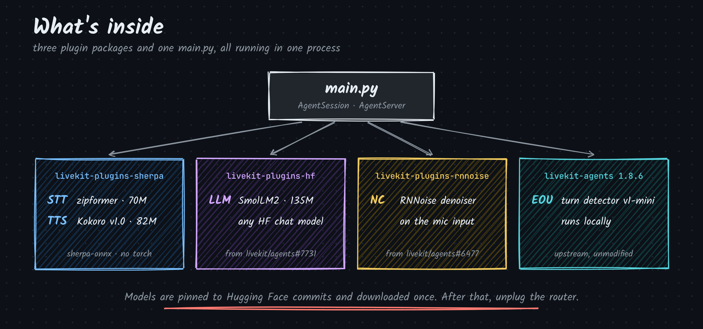

<p align="center">
  
</p>

<h3 align="center">A LiveKit voice agent that runs with the Wi-Fi off.</h3>

<p align="center">
  
  
  
  
</p>

Every model in the loop runs on your machine: ears, brain, voice. No API keys, no cloud, no bill.
Each piece is a real LiveKit plugin, laid out like `livekit/agents`, so it can move upstream on its own.
The upstream PRs take months to review. This repo shows them working together today.

<p align="center">
  
</p>

## Quickstart

```sh
git clone https://github.com/mahimairaja/local-livekit && cd local-livekit
uv sync
LIVEKIT_HF_MODELS=HuggingFaceTB/SmolLM2-135M-Instruct@12fd25f77366fa6b3b4b768ec3050bf629380bac \
  uv run -m livekit.agents download-files   # once, online
uv run python main.py console               # now turn the Wi-Fi off and talk
```

## Plugins

| Package | Role | Model | Size |
| --- | --- | --- | --- |
| `livekit-plugins-rnnoise` | Noise cancellation | RNNoise | built in |
| `livekit-plugins-sherpa` | Speech-to-text, streaming | zipformer (sherpa-onnx) | 70M, int8 |
| `livekit-agents` | Turn detection | `TurnDetector` v1-mini | local CPU |
| `livekit-plugins-hf` | LLM | SmolLM2-135M-Instruct | 135M |
| `livekit-plugins-sherpa` | Text-to-speech | Kokoro v1.0 (sherpa-onnx) | 82M, int8 |

Smallest models that work: the point is a loop that runs anywhere. Swap the LLM with `LLM_MODEL`, e.g. `Qwen/Qwen2.5-0.5B-Instruct`.

## Measured

On an M-series Mac mini, CPU only, voice in and voice out:

| | |
| --- | --- |
| End to end, per turn | ~3.4 s |
| LLM first token | 65 ms |
| Models on disk | 70M + 82M + 135M |

Most of the turn is Kokoro synthesizing the first sentence (~2.2 s). That is the next thing to cut.

<details>
<summary><b>Run it in a browser instead of the terminal</b></summary>

Start a local server with `livekit-server --dev`, then:

```sh
LIVEKIT_URL=ws://localhost:7880 LIVEKIT_API_KEY=devkey LIVEKIT_API_SECRET=secret \
  uv run python main.py dev
```
</details>

<details>
<summary><b>It greets me but never hears me</b></summary>

If the log says `microphone input is exact digital silence`, macOS is denying your terminal the microphone and handing it zeros. Enable your terminal in System Settings > Privacy & Security > Microphone, then quit and reopen it. To check:

```sh
uv run python -c "import sounddevice as sd, numpy as np; x=sd.rec(5*48000, samplerate=48000, channels=1, dtype='int16'); sd.wait(); print('RMS', int(np.sqrt((x.astype(float)**2).mean())))"
```

`RMS 0` is a denied permission. Normal speech reads in the hundreds.
</details>

<details>
<summary><b>Develop</b></summary>

```sh
uv run pytest                      # downloads the models on first run, then runs offline
uv run pre-commit run --all-files  # ruff, mypy --strict, uv lock --check
lk agent debugger start main.py    # drive the agent turn by turn, text mode
```

58 tests, including one where a spoken question has to come back as a spoken answer with no room and no network.
</details>

## Credits

- `livekit-plugins-rnnoise`: [Apoorva Verma](https://github.com/apoorva-01), [livekit/agents#6477](https://github.com/livekit/agents/pull/6477).
- `livekit-plugins-hf`: [livekit/agents#7731](https://github.com/livekit/agents/pull/7731).
- [sherpa-onnx](https://github.com/k2-fsa/sherpa-onnx) by k2-fsa, [Kokoro](https://huggingface.co/hexgrad/Kokoro-82M) and [misaki](https://github.com/hexgrad/misaki) by hexgrad, [SmolLM2](https://huggingface.co/HuggingFaceTB/SmolLM2-135M-Instruct) by Hugging Face, [RNNoise](https://github.com/xiph/rnnoise) by Xiph, and [LiveKit Agents](https://github.com/livekit/agents).
